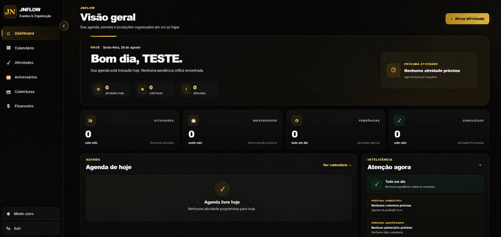
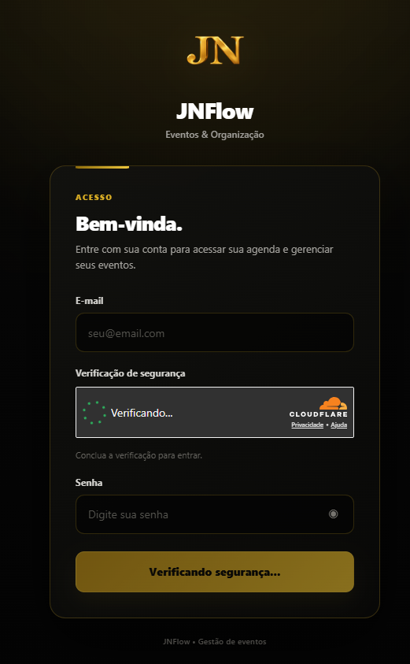
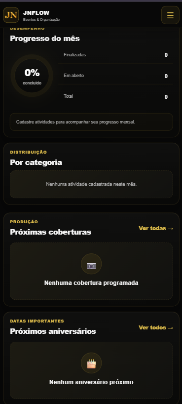
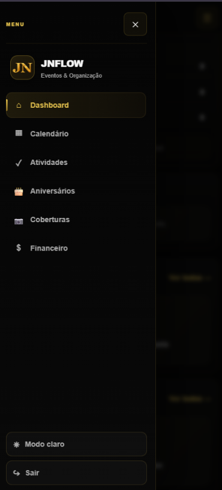
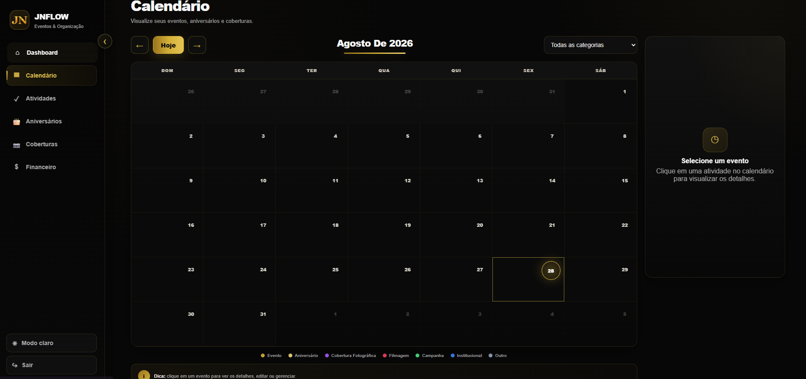
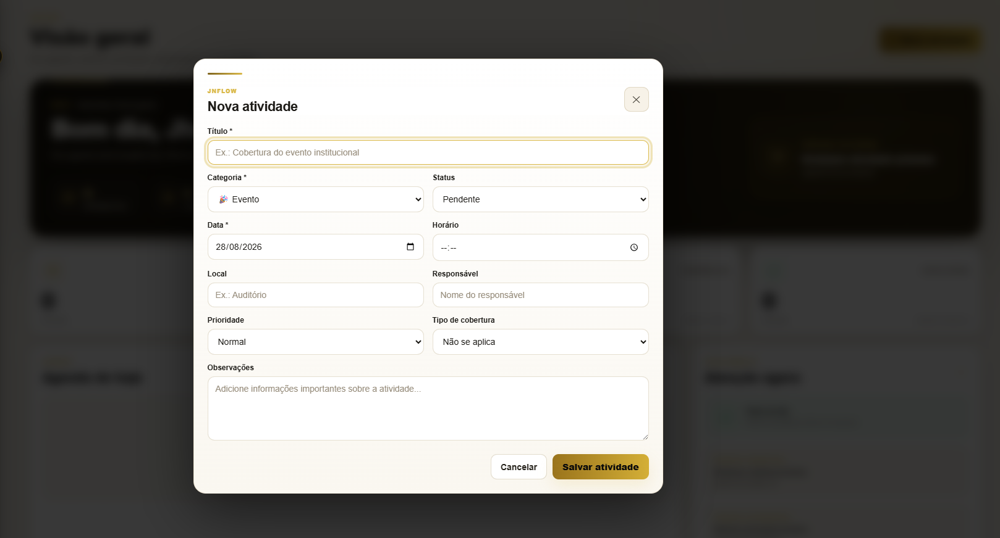

# JNFlow

<p align="center">
  
</p>

<p align="center">
  <strong>Gestão web de eventos, coberturas e fluxo financeiro.</strong><br>
  Uma experiência responsiva, com visual Black & Gold, para organizar a rotina de produção em desktop e mobile.
</p>

## Sobre o projeto

O JNFlow é uma aplicação web para centralizar agenda, atividades, aniversários, coberturas e lançamentos financeiros. O projeto foi pensado para simplificar o acompanhamento operacional de eventos, mantendo as informações de cada conta isoladas e disponíveis em diferentes dispositivos.

## Principais funcionalidades

- Dashboard com visão do dia, indicadores e próximos compromissos.
- Calendário mensal com categorias e painel de detalhes.
- Cadastro, edição, conclusão e exclusão de atividades.
- Visões dedicadas para aniversários e coberturas.
- Controle financeiro de entradas e saídas, com filtros, totais, baixa de lançamentos e vínculo opcional com uma atividade.
- Autenticação de usuários, logout e proteção de páginas privadas.
- Tema claro/escuro, sidebar adaptável e navegação otimizada para desktop e mobile.

## Tecnologias utilizadas

- HTML5, CSS3 e JavaScript modular (Vanilla JS).
- Supabase Auth e PostgreSQL/Data API para autenticação e persistência.
- Cloudflare Turnstile para proteção do formulário de login.
- Cloudflare Workers com Static Assets para hospedagem.
- Cloudflare Headers para políticas de segurança e cache de arquivos estáticos.

## Arquitetura em alto nível

```text
Navegador
├── Interface estática responsiva (HTML, CSS e JavaScript)
├── Camada de autenticação e proteção de rotas
├── Camada central de dados (data-service.js)
└── Cloudflare Turnstile
        │
        ▼
Supabase
├── Auth
├── PostgreSQL
└── Row Level Security (RLS)
        │
        ▼
Cloudflare Workers + Static Assets
```

As telas consomem uma camada central de dados, que mantém o formato esperado pela interface enquanto direciona atividades e lançamentos financeiros para o banco.

## Segurança

- Autenticação com sessão do Supabase e redirecionamento de páginas privadas.
- Proteção adicional do login com Cloudflare Turnstile.
- Isolamento de dados por usuário com RLS no banco e filtros de proprietário nas operações da aplicação.
- Política de Segurança de Conteúdo (CSP), proteção contra enquadramento por terceiros e demais headers de segurança.
- Subresource Integrity (SRI) na dependência externa aplicável.
- Tratamento de conteúdo dinâmico com escape de texto, uso preferencial de `textContent` e whitelist para classes/estados sensíveis da interface.
- Nenhuma credencial privilegiada de banco é usada pelo frontend.

## Performance

- Consultas com seleção de campos necessários e atualizações locais após mutações, evitando recargas integrais desnecessárias.
- Consultas independentes paralelizadas quando aplicável.
- Cache em memória apenas para o contexto de autenticação, com invalidação em eventos de sessão e logout.
- Scripts privados carregados de forma organizada para reduzir dependências em cascata.
- Cache longo para arquivos estáticos versionados; HTML com revalidação curta para entregar versões atuais.

## Interface e UX

- Identidade visual Black & Gold, com modo claro/escuro.
- Layout fluido para desktop e mobile.
- Sidebar recolhível no desktop e menu lateral próprio no mobile.
- Cards, filtros, modais, estados vazios e feedbacks para orientar as ações do usuário.
- Formulários e controles ajustados para toque e telas menores, sem perder a densidade de informação no desktop.

## Screenshots

As capturas abaixo usam dados fictícios e nomes anonimizados, como **TESTE**.

<p align="center">
  
</p>

<p align="center">
  
  
  
</p>

<p align="center">
  
  
</p>

## Status do projeto

**Em evolução ativa.** O fluxo principal de autenticação, gestão de atividades e controle financeiro já está integrado à persistência remota. As próximas entregas concentram-se em validações finais, melhorias contínuas de experiência e preparação operacional para novos usuários.

## Principais aprendizados

- Projetar uma interface responsiva exige reorganizar prioridades de conteúdo, e não apenas reduzir dimensões.
- Separar a camada de dados da interface torna a migração de armazenamento local para banco mais segura e gradual.
- Segurança no frontend é uma composição de controles: autenticação, RLS, validação de origem, proteção contra XSS, CSP e headers.
- Cache e paralelização precisam ser aplicados sem comprometer a atualização da sessão ou o isolamento de dados.
- Uma experiência de gestão eficiente depende tanto de feedbacks claros e estados vazios quanto dos recursos de cadastro e consulta.

---

Este repositório foi preparado para demonstração técnica e portfólio. Não inclui dados reais, credenciais privadas ou configurações sensíveis de infraestrutura.
